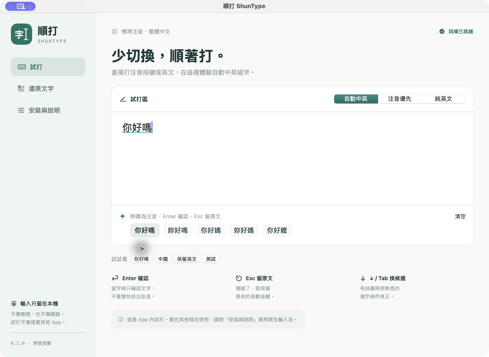

# ShunType 順打

ShunType is a macOS app for testing mixed English and Traditional Chinese Zhuyin input and recovering text typed with the wrong input source. It includes a typing editor, a text recovery tool, and an optional InputMethodKit input method.

[Download DMG](https://github.com/Joe05520/ShunType/releases/tag/v0.1.0-preview.2) · [Release notes](docs/RELEASE.zh-Hant.md) · [Validation record](docs/VALIDATION.zh-Hant.md) · [繁體中文](#繁體中文)

**Status:** development preview for Apple Silicon, with a macOS 14 deployment target. The app uses ad-hoc signing and has not been notarized by Apple. Gatekeeper may block downloaded copies. Earlier builds could fail to type because input-method metadata was missing and a later server initialization change crashed on macOS 27. This update fixes both errors and adds packaged startup and synthetic-client checks. Physical-keyboard input across apps is still unverified. Use the app editor and text recovery while system input validation is pending.



## What it does

- Interprets standard Daqian Zhuyin keystrokes, such as `su3cl3` → `你好`.
- Provides automatic, Zhuyin-first, and English-only modes.
- Keeps ambiguous input unchanged in automatic mode. Some short sequences require Zhuyin-first mode.
- Provides candidates and preserves the original keystrokes during composition.
- Recovers text pasted into the app. Results are copied only when the user chooses to copy them.
- Uses a bundled dictionary with 171,126 entries. Input processing runs locally without an account, network service, or downloaded model.

## Use the app

1. Download the DMG and drag **ShunType.app** to **Applications**.
2. Open the app and select **注音試打** (typing editor).
3. Type standard Zhuyin keystrokes or English. Examples: `su3cl3` → `你好`, `su3cl3a8` → `你好嗎`, and `5j/ eji6` → `中國`.
4. Press **Enter** to commit a composition, **Esc** to commit the original keystrokes, or **↓ / Tab** to cycle candidates.
5. To recover existing text, open **還原文字** (text recovery), paste the text, and review the result.

The first Enter commits an active composition. A subsequent Enter is handled by the host text field or app.

The downloaded preview is not notarized. If macOS blocks it, wait for a signed and notarized release or build the source with Xcode. Disabling Gatekeeper is not part of the installation procedure.

## Optional system input method

**Experimental; cross-app acceptance is pending.** The app includes a separate InputMethodKit bundle. Use **安裝與說明** (installation and instructions) to install it, then select **選用順打** and confirm **選用測試** to enable it for a test in a blank document. **切回 ABC** returns to the system ABC input source. It can also be added through macOS Keyboard settings; earlier builds were incorrectly listed under English because their input-method metadata was missing. macOS may retain cached information until the next login. A logout and login may be needed before macOS lists the input method.

ShunType must be the selected input source to process input in other apps. Selecting ABC stops ShunType from processing that session. Keep ABC and your existing Chinese input method available.

In the system input method, **Control + Backslash (`\`)** cycles through the three modes. Mode selection is local to an input session in version 0.1.

| Mode | Behavior |
|---|---|
| Automatic / 自動中英 | Converts complete Zhuyin sequences with sufficient evidence; otherwise preserves the input |
| Zhuyin-first / 注音優先 | Shows Chinese candidates for valid Zhuyin, including single syllables |
| English-only / 純英文 | Outputs literal characters without Zhuyin conversion |

## Privacy and limitations

- No global keyboard event tap, clipboard polling, cloud API, or stored typing history. Accessibility, Screen Recording, and Full Disk Access permissions are not requested.
- The dictionary and ranking rules can choose the wrong homophone. Candidate coverage tests are not a measure of first-candidate accuracy.
- Standard Daqian Zhuyin and ANSI physical key positions are supported. Other layouts and key remapping require testing.
- Missing first-tone separator spaces, incorrect tones, short letter-only input, and Chinese/English sequences without boundaries may be left unchanged.
- System input registration, app-specific undo behavior, secure fields, vertical text, remote desktops, and compatibility across apps and macOS versions need further acceptance testing. See the validation record for the current scope.
- The project has not completed a comparative evaluation against other input tools.

## Build from source

Development requires macOS 14+, Swift 6.0+ through Xcode or Command Line Tools, and Python 3 for packaging. Users of a built app do not need these tools.

```sh
swift test
swift run ShunTypeCheck 'su3cl3'
python3 scripts/package.py
```

Outputs are written to `outputs/`: the app, DMG, checksums, and build manifest. Packaging runs `--self-check` on both packaged executables and stops if startup or synthetic-client checks fail. These checks do not register, enable, or select an input source and do not establish cross-app compatibility. Building does not install or enable the input method. The DMG architecture matches the build machine; it is not a Universal build.

The pinned dictionary is included in the repository. To regenerate it:

```sh
python3 scripts/prepare_dictionary.py
```

## Source layout

```text
Sources/ShunTypeCore/         Parsing, candidate ranking, composition, dictionary
Sources/ShunType/             SwiftUI / AppKit app and installation UI
Sources/ShunTypeInputMethod/  InputMethodKit input method
Sources/ShunTypeCheck/        Core checks and benchmark
Tests/                       Decoder and composition tests
scripts/                     Dictionary preparation and app / DMG packaging
docs/                        Plan, limitations, validation, and publishing notes
```

## License and data source

The app code is available under the [MIT License](LICENSE). Dictionary data comes from [McBopomofo](https://github.com/openvanilla/McBopomofo) with its [MIT license retained](Sources/ShunTypeCore/Resources/McBopomofo-LICENSE.txt). The pinned revision and SHA-256 hashes are recorded in [dictionary-source.json](Sources/ShunTypeCore/Resources/dictionary-source.json).

---

## 繁體中文

順打是 macOS App，用來測試英文與繁體中文注音混合輸入，以及還原忘記切換輸入法時打出的英數字串。包含注音試打、文字還原，以及可另外安裝的原生輸入法。

[下載 DMG](https://github.com/Joe05520/ShunType/releases/tag/v0.1.0-preview.2) · [開發計畫](docs/PLAN.zh-Hant.md) · [驗證紀錄](docs/VALIDATION.zh-Hant.md)

**目前為開發預覽。** DMG 為 Apple Silicon 版本，部署目標 macOS 14 以上。尚未取得 Developer ID 簽署與 Apple 公證，下載版可能被 Gatekeeper 阻擋。舊版曾因輸入法封裝缺少必要設定，以及後續初始化修改造成啟動崩潰，而無法打字。本版修正這兩處錯誤，並加入封裝啟動及模擬文字框檢查；跨 App 實體鍵盤驗收仍未完成，請先使用 App 內試打與文字還原。實際已測與未測範圍列在驗證紀錄。

### 使用方式

1. 開啟 DMG，把 `ShunType.app` 拖到「應用程式」。
2. 開啟 App，在「注音試打」輸入標準注音按鍵或英文。
3. `su3cl3` 對應「你好」；`su3cl3a8` 對應「你好嗎」；`5j/ eji6` 對應「中國」。
4. Enter 確認組字，Esc 保留原始英數，↓／Tab 換候選。組字中的第一個 Enter 只確認文字，下一個 Enter 才交給文字框或原 App 處理。
5. 已打錯的文字可貼到「還原文字」，檢查後自行複製結果。

### 三種模式

- **自動中英：** 有完整注音及足夠線索才轉換；不明確時保留原文。
- **注音優先：** 對有效注音顯示中文，包含單音節。
- **純英文：** 直接輸出英數，不做注音轉換。

**原生輸入法仍在測試中。** 如需在空白文件進行測試，可從「安裝與說明」安裝輸入法，再按「選用順打」並確認「選用測試」。「切回 ABC」可返回系統英文輸入。也可從 macOS 鍵盤設定加入；舊版因缺少輸入法設定而被列在「英文」分類，macOS 可能保留快取，部分系統需要登出再登入。原生輸入法可用 Control + 反斜線（`\`）輪換模式。切回 ABC 後，順打不會處理輸入。

### 資料處理與限制

詞庫隨 App 附上，包含 171,126 筆資料。輸入在本機處理，不需帳號、雲端服務或額外模型；不記錄打字歷史，不建立全域鍵盤監聽，也不輪詢剪貼簿。只有按下「複製結果」才會寫入剪貼簿。

目前支援標準大千注音與 ANSI 實體鍵位。同音字仍可能選錯；短字串、缺少第一聲分隔空白、錯誤聲調或中英文直接黏在一起時，可能不轉換。其他鍵盤配置、各 App 的復原操作、安全輸入、直排、遠端桌面與不同 macOS 版本仍需測試。請保留 ABC 與原有注音輸入法。

若 macOS 阻擋下載版，請等待正式簽署與公證版本，或使用 Xcode 從原始碼建置。安裝流程不包含關閉 Gatekeeper。

建置指令與原始碼目錄見上方英文說明。程式碼採 MIT 授權；注音資料來自 McBopomofo，保留上游授權及來源雜湊。
